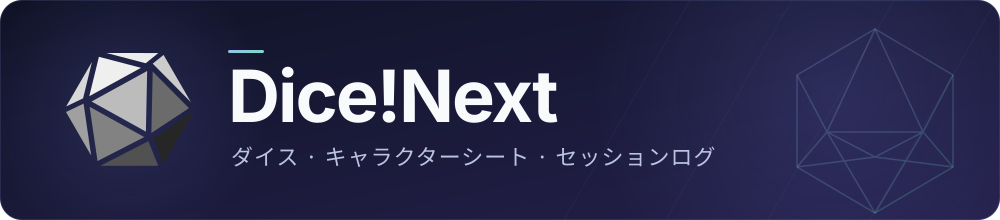

<p align="center">
  
</p>

<p align="center">
  <a href="README.md">English</a> · <a href="README.zh-Hans.md">简体中文</a> · <a href="README.zh-Hant.md">繁體中文</a> · <b>日本語</b>
</p>

<p align="center">
  <a href="https://github.com/DiceZone/Dice-Next/releases"></a>
  <a href="https://github.com/DiceZone/Dice-Next/actions/workflows/release.yml"></a>
  <a href="LICENSE"></a>
</p>

<p align="center">
  <a href="https://github.com/DiceZone/Dice-Next/releases">ダウンロード</a> ·
  <a href="#クイックスタート">クイックスタート</a> ·
  <a href="https://docs.dice.zone/ja/">ドキュメント</a> ·
  <a href="https://github.com/DiceZone/Dice-Next/issues">問題の報告</a>
</p>

Dice!Next は TRPG のセッション向けの、自分で運用するダイスボットです。ボットのアカウントをつなぐと、チャットでダイスを振り、キャラクターシートを管理し、セッションを記録できます。設定と保守は Web のパネルで行います。

現在は公開テスト（Beta）の段階で、Windows、Linux、macOS の配布パッケージと [Docker での導入の方法](https://github.com/DiceZone/Dice-Next-Docker)を提供しています。

## クイックスタート

1. [Releases](https://github.com/DiceZone/Dice-Next/releases) の **Assets** から、システムとアーキテクチャに合うパッケージをダウンロードします。`Source code` は選ばないでください。決まったフォルダーに完全に展開し、圧縮ファイルの中やシステムの一時フォルダーで実行しないでください。
2. 次の表のとおりに起動します。配布パッケージには WebUI が含まれているので、フロントエンドを別にビルドする必要はありません。

   | システム | アーキテクチャ / 形式 | 起動の方法 |
   | --- | --- | --- |
   | Windows | x64（amd64）/ ARM64 · `.zip` | `dice-next.exe` をダブルクリック |
   | Linux | x64（amd64）/ ARM64 · `.tar.gz` | 展開したフォルダーで `./start.sh` を実行 |
   | macOS | Apple Silicon（arm64）· `.tar.gz` | 展開したフォルダーで `./start.sh` を実行 |

3. [http://localhost:18088](http://localhost:18088) を開き、案内に従って管理用のパスワードを設定します。Windows では既定でシステムトレイで動き、トレイのアイコンを右クリックして「Web パネルを開く」を選ぶこともできます。ポートが使われているときは、空いているポートに自動で切り替えます。
4. 「アダプター管理」で接続を追加し、接続できたらコマンドを送ります。

   ```text
   .help
   .r 3d6+2
   .r 2#d100
   ```

まだチャットのプラットフォームにつないでいなければ、まずパネルの「テスト台」でコマンドを試せます。起動や接続で問題があれば、[インストール](https://docs.dice.zone/ja/guide/install.html)と[トラブルシューティング](https://docs.dice.zone/ja/guide/troubleshooting.html)を参照してください。

## できること

| 場面 | 機能 |
| --- | --- |
| ダイスと判定 | 一般のダイスの式、シークレットダイス、連続のロール。COC / DND / BRP の判定、ボーナス・ペナルティダイス、ハウスルール |
| キャラクターとセッション | キャラクターシート、NPC、イニシアチブ、セッションの管理、複数のグループでのセッション |
| デッキと返信 | 内蔵とカスタムのデッキ、キーワード / 正規表現の返信。ダイスの文章とペルソナは重み付きの複数の候補を持て、入れ子の `{sample:甲\|乙}` に対応 |
| セッションのログ | グループチャットの記録、ログサイトへのアップロード、TXT / Excel / HTML の書き出し。ログは通常の `bot off` とは別に制御できる |
| Web での管理 | アダプター、グループ、プレイヤー、権限、プラグイン、ルールパック。全体の設定の検索、コマンドのテスト、活動とオンラインの履歴の統計 |
| プラグインとルール | Lua のプラグイン / モジュール、SealDice 形式の JS プラグイン、カスタムのルールパックとキャラクターシートのテンプレート |
| 日々の保守 | バックアップと復元、定期タスクとプラグインのコマンドの呼び出し、通知、禁止語の遮断。必要に応じて BDC のクラウドのキャラクターシート、クラウドのブラックリスト、ハートビートにつなげる |

画面と返信は簡体字中国語、繁体字中国語、英語、日本語を内蔵しています。コマンド、設定、プラグインの完全な説明は[ドキュメントサイト](https://docs.dice.zone/ja/)を参照してください。

## 接続と互換

QQ は **OneBot v11**（フォワード / リバースの WebSocket）、**Milky**（HTTP API + WebSocket のイベント）、**QQ 公式ボット** でつなげます。Discord と KOOK にも対応し、複数のアダプターを同時に管理できます。接続の引数は[アダプターの設定](https://docs.dice.zone/ja/config/adapter.html)を参照してください。

Dice!Next 自体は QQ のプロトコルのクライアントではありません。OneBot / Milky を使うときは、対応するプロトコルのサービスを別に動かす必要があります。メッセージの形式、グループの管理、ファイルの送信などの機能は、プラットフォームの権限とプロトコルのクライアントが対応する範囲に制限されます。

旧版からの移行とプラグインの互換の範囲：

- 旧版 Dice! のコマンドの習慣と Lua の生態系を互換の目標にしています。**JS プラグインは SealDice に合わせており、旧版 Dice! の JS ではありません**。
- 旧版 Dice! のキャラクターシート、グループの設定、返信、デッキ、プラグイン、ログの一部を取り込めます。具体的な範囲は[データの移行](https://docs.dice.zone/ja/guide/migration.html)を参照してください。
- すべての古いプラグインがそのまま動くことは保証せず、リモートのシェルなどの危険の高い機能も持ち込みません。移行の後は古いフォルダーを残し、テストのグループで結果を確認してください。

## 更新とデータ

設定と主なユーザーのデータは、プログラムのフォルダーの `config/` と `data/` に保存されます。パネルには手動 / 定期のバックアップと復元があります。アップグレードの前にはバックアップしてください。

- **Windows の配布パッケージ**：「について」で更新の確認、ダウンロード、インストールができます。先にダウンロードしておき、サーバーのタイムゾーンで予定時刻にインストールすることもでき、既定は午前 04:00 です。
- **Linux / macOS**：POSIX のマネージャーを含む完全なパッケージを `start.sh` または `dice-next` で起動すると、インストールと再起動、予定時刻での自動インストールに対応します。古いパッケージ（beta.928 を含む）はまず一度手動でアップグレードする必要があります。`dice-next-server` を直接実行する場合は、引き続き確認とダウンロードだけに対応します。
- **コンテナーでの導入**：バージョンの確認だけを行い、コンテナーの中でプログラムの更新のダウンロードやインストールはしません。新しいイメージを取得してコンテナーを作り直すことでアップグレードします。

具体的な操作は[インストールとアップグレード](https://docs.dice.zone/ja/guide/install.html)を参照してください。管理パネルは既定ですべてのネットワークのインターフェースで待ち受けます。リモートからアクセスするときは、ファイアウォールで接続元を制限し、HTTPS のリバースプロキシを通してください。管理用のポートをそのまま公開しないでください。

## 開発と貢献

バックエンドは C++20、管理パネルは React を使っています。ビルドと依存の説明は[ソースからのビルド](https://docs.dice.zone/ja/develop/build.html)を、プラグインの作者は[プラグイン開発](https://docs.dice.zone/ja/develop/plugin-quickstart.html)から始めてください。

<details>
<summary>関連するリポジトリとソースからのビルドの配置</summary>

ビルドのスクリプトは同じ階層のフォルダーから依存とリソースを探します。配布パッケージを使うだけなら、これらのリポジトリを複製する必要はありません。

| リポジトリ | 用途 |
| --- | --- |
| [Dice-Next](https://github.com/DiceZone/Dice-Next) | このリポジトリ：バックエンド、ランチャー、パッケージの作成 |
| [Dice-Next-WebUI](https://github.com/DiceZone/Dice-Next-WebUI) | 管理パネル |
| [Dice-Next-Doc](https://github.com/DiceZone/Dice-Next-Doc) | 文書とコマンドのデータ |
| [Dice-Next-Docker](https://github.com/DiceZone/Dice-Next-Docker) | コンテナーでの導入（任意） |
| [onedice-cpp-lib](https://github.com/DiceZone/onedice-cpp-lib) | OneDice の式のエンジン（バックエンドのビルドに必須） |
| [dicescript-c-lib](https://github.com/DiceZone/dicescript-c-lib) | DiceScript の式のエンジン（バックエンドのビルドに必須） |

貢献の約束は [CONTRIBUTING.md](CONTRIBUTING.md)、公開のビルドの説明は [docs/ci-release-build.md](docs/ci-release-build.md) を参照してください。

</details>

## フィードバック

問題や提案は [Issue](https://github.com/DiceZone/Dice-Next/issues) で送ってください。バージョン、プラットフォーム、再現の手順、ログを添えてください。共有する前にパスワード、キー、個人の情報は隠してください。交流用の QQ グループ：`933145116`。

## 謝辞

このプロジェクトは [Dice!](https://github.com/Dice-Developer-Team/Dice) への敬意を込めた作り直しで、**元のプロジェクトの公式の後継の版ではありません**。w4123 溯洄、String.Empty（Shiki）、Dice! の開発者と貢献者の皆さんに感謝します。

あわせて、次のプロジェクトとコミュニティにも感謝します。

- [OneDice](https://github.com/OlivOS-Team/lib-onedice)：ダイスの式の仕様。
- [SealDice](https://github.com/sealdice/sealdice-core)：JS プラグインの互換と相互運用の参考。
- [OlivaDice](https://github.com/OlivOS-Team/OlivaDiceCore)：OneDice の生態系とダイスボットのコマンドの習慣の参考。
- [OneBot v11](https://github.com/botuniverse/onebot-11)：ボットのプラットフォームへの対応のプロトコル。
- [NapCat](https://github.com/NapNeko/NapCatQQ)：QQ のプロトコルのクライアントと OneBot の生態系の支援。
- [LLOneBot](https://www.llonebot.com/)：QQ のプロトコルのクライアントと OneBot の生態系の支援。
- [SnowLuma](https://github.com/SnowLuma/SnowLuma)：QQ のプロトコルのクライアント、そしてこの README のレイアウトの参考。

開発、テスト、フィードバック、文書の保守に参加してくださったすべての貢献者とユーザーに感謝します。

## ライセンス

このプロジェクトは **AGPL-3.0-or-later** で公開しています。完全な条項は [LICENSE](LICENSE) を参照してください。
