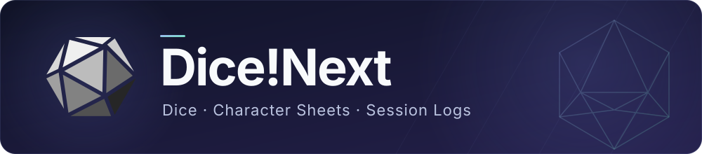

<p align="center">
  
</p>

<p align="center">
  <b>English</b> · <a href="README.zh-Hans.md">简体中文</a> · <a href="README.zh-Hant.md">繁體中文</a> · <a href="README.ja.md">日本語</a>
</p>

<p align="center">
  <a href="https://github.com/DiceZone/Dice-Next/releases"></a>
  <a href="https://github.com/DiceZone/Dice-Next/actions/workflows/release.yml"></a>
  <a href="LICENSE"></a>
</p>

<p align="center">
  <a href="https://github.com/DiceZone/Dice-Next/releases">Download</a> ·
  <a href="#quick-start">Quick start</a> ·
  <a href="https://docs.dice.zone/en/">Docs</a> ·
  <a href="https://github.com/DiceZone/Dice-Next/issues">Issues</a>
</p>

Dice!Next is a self-hosted dice bot for tabletop RPG sessions. Connect your bot account to roll dice, manage character sheets and record sessions in chat, and configure and maintain everything from a web panel.

It's currently in public beta, with release packages for Windows, Linux and macOS and a [Docker deployment](https://github.com/DiceZone/Dice-Next-Docker).

## Quick Start

1. Download the package for your system and architecture from the **Assets** of [Releases](https://github.com/DiceZone/Dice-Next/releases); don't pick `Source code`. Extract it completely to a fixed directory, and don't run it from inside the archive or the system temporary directory.
2. Start it as shown below. The release packages already include the WebUI, so there's no frontend to build.

   | System | Architecture / format | How to start |
   | --- | --- | --- |
   | Windows | x64 (amd64) / ARM64 · `.zip` | Double-click `dice-next.exe` |
   | Linux | x64 (amd64) / ARM64 · `.tar.gz` | Run `./start.sh` in the extracted directory |
   | macOS | Apple Silicon (arm64) · `.tar.gz` | Run `./start.sh` in the extracted directory |

3. Open [http://localhost:18088](http://localhost:18088) and follow the prompts to set an admin password. On Windows it runs in the system tray by default, and you can also right-click the tray icon and choose "Open web panel"; if the port is taken, another free port is used automatically.
4. Add a connection under "Adapters". Once it's connected, send some commands:

   ```text
   .help
   .r 3d6+2
   .r 2#d100
   ```

Not connected to a chat platform yet? Try commands in the panel's "Playground" first. If you run into startup or connection problems, see [Installation](https://docs.dice.zone/en/guide/install.html) and [Troubleshooting](https://docs.dice.zone/en/guide/troubleshooting.html).

## What It Does

| Area | Features |
| --- | --- |
| Rolls and checks | General dice expressions, hidden rolls, repeated rolls; COC / DND / BRP checks, bonus / penalty dice and house rules |
| Characters and games | Character sheets, NPCs, initiative, game management and games across several groups |
| Decks and replies | Built-in and custom decks, keyword / regex replies; dice texts and personas can have several weighted variants, with nested `{sample:A\|B}` |
| Session logs | Group chat logging, log site upload, TXT / Excel / HTML export; logging can be controlled separately from the ordinary `bot off` |
| Web management | Adapters, groups, players, permissions, plugins and rule packs; global settings search, command playground, activity and online history statistics |
| Plugins and rules | Lua plugins / mods, SealDice-style JS plugins, custom rule packs and character sheet templates |
| Maintenance | Backup and restore, scheduled tasks and plugin command calls, notifications, sensitive word blocking; optional BDC cloud character sheets, cloud blacklist and heartbeat |

The interface and replies come in Simplified Chinese, Traditional Chinese, English and Japanese. For the full commands, configuration and plugin docs, see the [documentation site](https://docs.dice.zone/en/).

## Platforms and Compatibility

QQ can be connected through **OneBot v11** (forward / reverse WebSocket), **Milky** (HTTP API + WebSocket events) or the **QQ Official Bot**; Discord and KOOK are supported too, and several adapters can be managed at once. For connection parameters see [Adapter configuration](https://docs.dice.zone/en/config/adapter.html).

Dice!Next itself isn't a QQ protocol client; with OneBot / Milky you need to run the matching protocol service separately. Message formats, group management, file sending and other capabilities are limited by platform permissions and what the protocol client supports.

Scope of legacy migration and plugin compatibility:

- The compatibility targets are the old Dice! command habits and Lua ecosystem; **JS plugins follow SealDice, not the old Dice! JS**.
- Part of the old Dice! character sheets, group settings, replies, decks, plugins and logs can be imported; for the exact scope see [Data migration](https://docs.dice.zone/en/guide/migration.html).
- Not every old plugin is guaranteed to run unchanged, and high-risk capabilities such as the remote shell aren't carried over. After migrating, keep the old directory and check the results in a test group.

## Updates and Data

Configuration and the main user data are stored in `config/` and `data/` in the program directory. The panel provides manual / scheduled backups and restore; back up before upgrading.

- **Windows packages**: check for, download and install updates from "About"; you can download first and install at a scheduled time in the server's time zone, 04:00 by default.
- **Linux / macOS**: full packages that include the POSIX manager, started via `start.sh` or `dice-next`, support installing and restarting as well as scheduled automatic installation. Older packages (including beta.928) need one manual upgrade first; running `dice-next-server` directly still only supports checking and downloading.
- **Containers**: only check the version, without downloading or installing program updates inside the container; upgrade by pulling the new image and recreating the container.

For details see [Installation and upgrades](https://docs.dice.zone/en/guide/install.html). The admin panel listens on all network interfaces by default; for remote access, restrict sources with a firewall and use an HTTPS reverse proxy instead of exposing the admin port directly.

## Development and Contributing

The backend uses C++20 and the admin panel uses React. For build and dependency notes see [Building from source](https://docs.dice.zone/en/develop/build.html); plugin authors can start with [Plugin development](https://docs.dice.zone/en/develop/plugin-quickstart.html).

<details>
<summary>Related repositories and the source build layout</summary>

The build scripts look for dependencies and resources in sibling directories; you don't need to clone these repositories to use the release packages.

| Repository | Purpose |
| --- | --- |
| [Dice-Next](https://github.com/DiceZone/Dice-Next) | This repository: backend, launcher and packaging |
| [Dice-Next-WebUI](https://github.com/DiceZone/Dice-Next-WebUI) | Admin panel |
| [Dice-Next-Doc](https://github.com/DiceZone/Dice-Next-Doc) | Documentation and command data |
| [Dice-Next-Docker](https://github.com/DiceZone/Dice-Next-Docker) | Container deployment (optional) |
| [onedice-cpp-lib](https://github.com/DiceZone/onedice-cpp-lib) | OneDice expression engine (required for backend builds) |
| [dicescript-c-lib](https://github.com/DiceZone/dicescript-c-lib) | DiceScript expression engine (required for backend builds) |

For contribution conventions see [CONTRIBUTING.md](CONTRIBUTING.md), and for release builds [docs/ci-release-build.md](docs/ci-release-build.md).

</details>

## Feedback

Please open an [Issue](https://github.com/DiceZone/Dice-Next/issues) for problems and suggestions, including the version, platform, steps to reproduce and logs; remove passwords, keys and personal information before sharing. QQ group: `933145116`.

## Acknowledgements

This project is a tribute rewrite of [Dice!](https://github.com/Dice-Developer-Team/Dice) and **is not an official successor of the original project**. Thanks to w4123 溯洄, String.Empty (Shiki), and the developers and contributors of Dice!.

Thanks also to these projects and communities:

- [OneDice](https://github.com/OlivOS-Team/lib-onedice): the dice expression specification.
- [SealDice](https://github.com/sealdice/sealdice-core): the reference for JS plugin compatibility and interoperability.
- [OlivaDice](https://github.com/OlivOS-Team/OlivaDiceCore): the reference for the OneDice ecosystem and dice bot command habits.
- [OneBot v11](https://github.com/botuniverse/onebot-11): the bot platform adapter protocol.
- [NapCat](https://github.com/NapNeko/NapCatQQ): QQ protocol client and OneBot ecosystem support.
- [LLOneBot](https://www.llonebot.com/): QQ protocol client and OneBot ecosystem support.
- [SnowLuma](https://github.com/SnowLuma/SnowLuma): QQ protocol client, and the reference for this README's layout.

Thanks to all the contributors and users who take part in development, testing, feedback and documentation.

## License

This project is released under **AGPL-3.0-or-later**; see [LICENSE](LICENSE) for the full terms.
